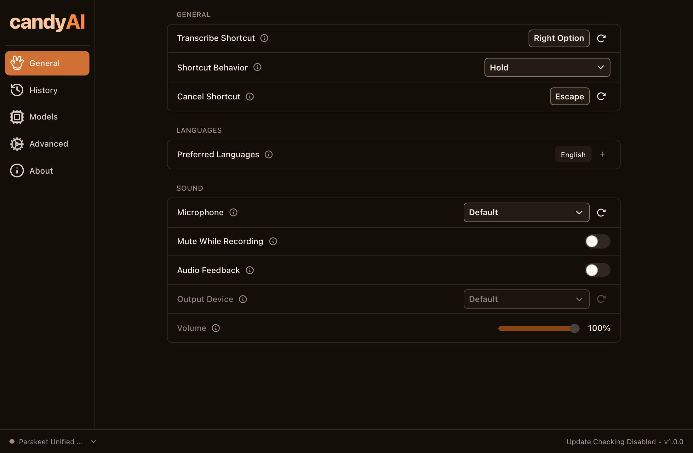
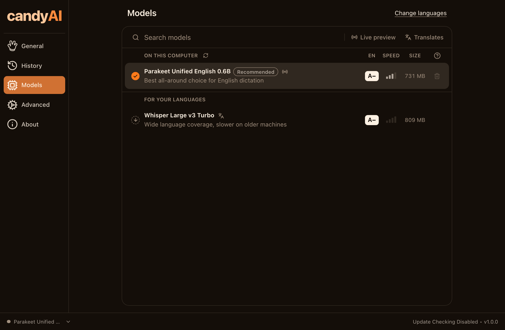
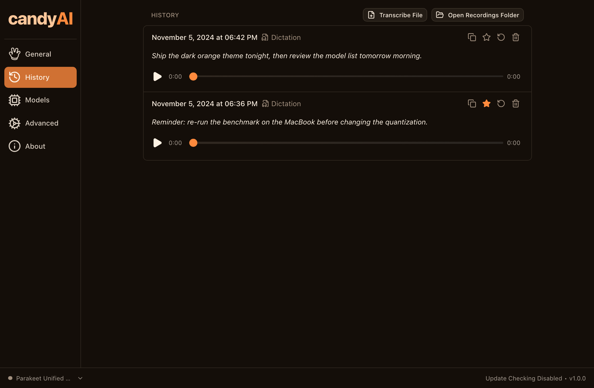
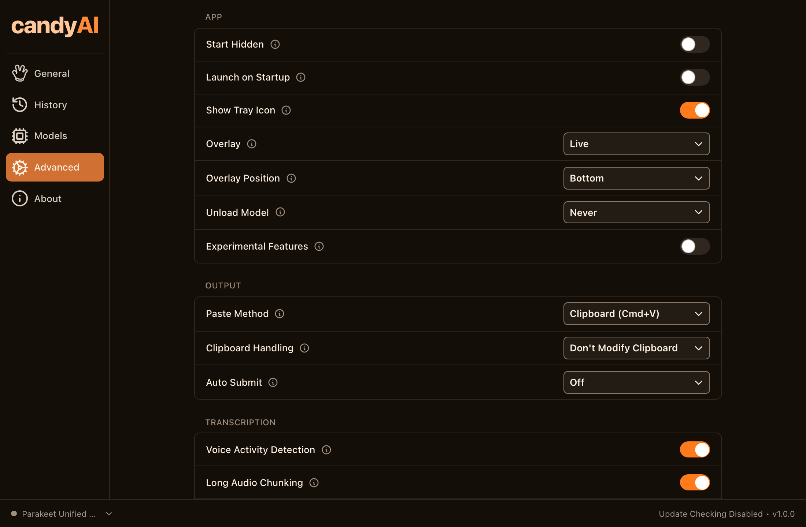
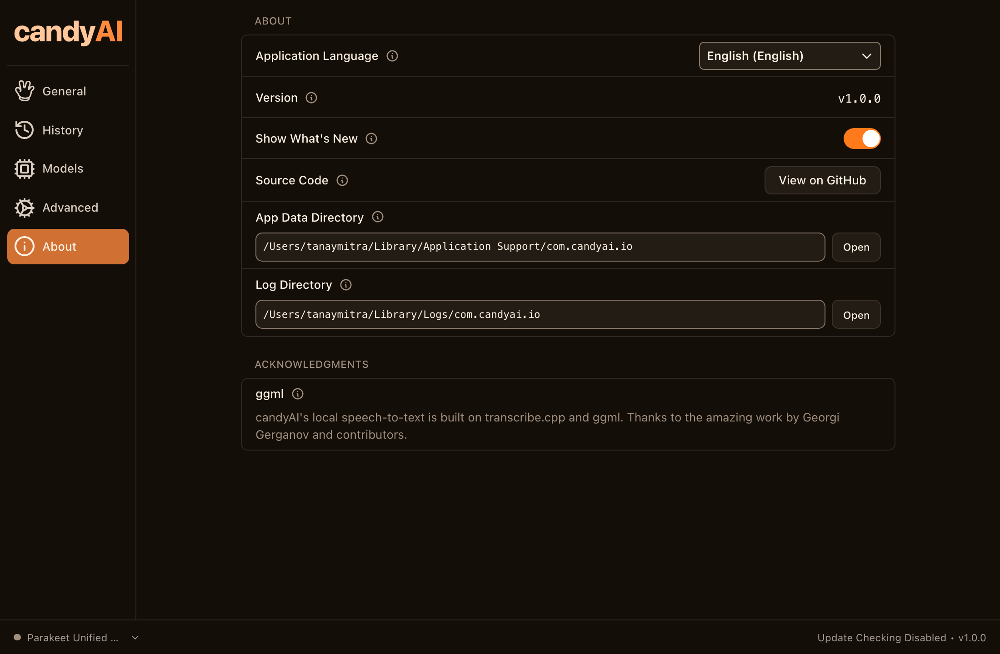

<p align="center">
  
</p>

<h1 align="center">candyAI</h1>

<p align="center">
  Private, on-device speech to text for macOS.<br/>
  Hold a key, speak, and the words appear where your cursor is.
</p>

<p align="center">
  
  
  
  
</p>

---

## Screenshots

All screenshots are renders of candyAI's own frontend with a stubbed native layer, captured at
2× on a 1100×720 window. Reproduce them with `bun run dev` and `node scripts/shot.mjs`.

### General



### Models



### History



### Advanced



### About



---

## What it does

- Global shortcut dictation, hold-to-talk or tap-to-toggle
- Fully local transcription on Metal (Apple Silicon), no network calls
- Default model: **Parakeet Unified English 0.6B**, Q8_0 GGUF
- Recording overlay, menu bar control, searchable history
- Optional post-processing through an LLM provider you configure yourself
- Self-update disabled; the build you install is the build you keep

## Design

Dark only. No light mode, and no following the OS. Warm orange palette, one token file.

| Role | Token | Value |
|---|---|---|
| Background | `--color-background` | `#140e09` |
| Text | `--color-text` | `#fdf1e3` |
| Primary | `--color-logo-primary` | `#ff8a3d` |
| Action fill | `--color-background-ui` | `#ff7a1a` |
| Accent | `--color-orange-soft` | `#ffc79a` |

Colours live in [`src/styles/theme.css`](src/styles/theme.css). Contrast was audited to
WCAG 2.2 — every body-text pair clears 4.5:1, and primary buttons use dark ink on orange
rather than white.

## Requirements

- macOS on Apple Silicon (verified on M1)
- Rust stable
- [Bun](https://bun.sh)
- Xcode Command Line Tools

## Build

```bash
bun install

mkdir -p src-tauri/resources/models
curl -L -o src-tauri/resources/models/silero-vad-v6.2-F32.gguf \
  https://huggingface.co/handy-computer/silero-vad-v6.2-gguf/resolve/main/silero-vad-v6.2-F32.gguf

CMAKE_POLICY_VERSION_MINIMUM=3.5 bun run tauri build --bundles app
```

The bundle lands in `src-tauri/target/release/bundle/macos/candyAI.app`.

The build is ad-hoc signed. It runs on the machine that produced it; distributing it needs a
Developer ID and notarization.

## Default model

Set in [`src-tauri/src/settings.rs`](src-tauri/src/settings.rs):

```
handy-computer/parakeet-unified-en-0.6b-gguf/parakeet-unified-en-0.6b-Q8_0.gguf
```

Weights download on first use from Hugging Face and are cached in
`~/Library/Application Support/com.candyai.io/models/`. They are not in this repository.

Measured on an M1: 49 s of audio transcribed in 4.2 s, about 11.6× real time, Metal backend.

## Licence and attribution

MIT. candyAI is a redistribution of [Handy](https://github.com/cjpais/Handy) by CJ Pais.
The upstream copyright notice is retained in [LICENSE](LICENSE), and every modification is
listed in [NOTICE.md](NOTICE.md).

The default model weights are licensed **CC-BY-4.0** by NVIDIA, separately from this
application's code.
